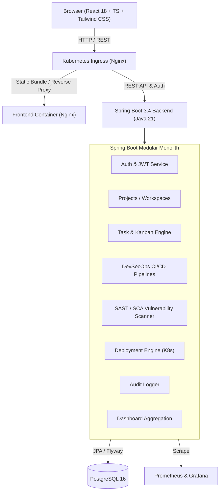

# Cloud-Native DevSecOps Dashboard & Operations Platform

An enterprise-grade, cloud-native **DevSecOps Dashboard & Engineering Operations Platform** developed with **Spring Boot 3.4 (Java 21)**, **PostgreSQL**, **React 18 & TypeScript**, **Tailwind CSS**, **Docker**, **Kubernetes (Helm)**, and **GitHub Actions**.

The platform provides unified visibility across engineering tasks (Agile Kanban), CI/CD pipelines, container scans, multi-environment cluster deployments, real-time security vulnerabilities (SAST/SCA), and compliance audit trails.

---

## 🏗️ System Architecture



---

## ⚡ Key Features

- **Authentication & RBAC**: JWT Access & Refresh Token rotation with Spring Security. Role-based permissions (`ADMIN`, `MANAGER`, `DEVELOPER`, `VIEWER`).
- **DevSecOps CI/CD Module**: 7-stage automated pipeline (`SOURCE` → `BUILD` → `TEST` → `SAST` → `DEPENDENCY_SCAN` → `CONTAINER_SCAN` → `DEPLOY`) with stage metrics and execution logs.
- **Security Vulnerability Scanner**: Tracking for CVEs, Semgrep SAST issues, Trivy SCA findings, severity levels (`CRITICAL`, `HIGH`, `MEDIUM`, `LOW`), and automated security score calculations.
- **Sprint & Task Management**: Interactive Agile Kanban board with drag-and-drop / stage transitions, priority badges, story points, and project filtering.
- **Multi-Environment Deployments**: Track Kubernetes cluster releases across `DEV`, `STAGING`, and `PRODUCTION`.
- **Enterprise Audit Logging**: Centralized compliance audit trail tracking security and operational actions with IP addresses and timestamps.
- **Omni-Search**: Instant search across projects, tasks, pipelines, and team members.
- **Observability**: Spring Boot Actuator, Prometheus metrics endpoint (`/actuator/prometheus`), and Grafana dashboard integration.
- **Database Migrations**: Version-controlled migrations using Flyway (`V1__initial_schema.sql`, `V2__seed_demo_data.sql`).

---

## 🛠️ Technology Stack

### Backend
- **Language**: Java 21 LTS
- **Framework**: Spring Boot 3.4.3
- **Security**: Spring Security 6, JJWT (0.12.6), BCrypt Password Hashing
- **Data & Persistence**: Spring Data JPA, Hibernate ORM, Flyway Migrations
- **Databases**: PostgreSQL 16 (Production/Dev), H2 (In-memory testing)
- **API Documentation**: OpenAPI 3.0 / Swagger UI (`springdoc-openapi`)
- **Metrics**: Spring Boot Actuator, Micrometer Prometheus

### Frontend
- **Framework**: React 18, TypeScript, Vite
- **Styling**: Tailwind CSS, Dark / Light mode support
- **State & Routing**: React Router v6, Context API
- **Charts & Data Viz**: Recharts
- **Icons**: Lucide React
- **HTTP Client**: Axios with automated JWT refresh interceptor

### DevOps & Cloud-Native
- **Containerization**: Multi-stage Dockerfiles (Temurin 21 JRE, Nginx Alpine, non-root users)
- **Local Dev**: Docker Compose (PostgreSQL, Backend, Frontend, Prometheus, Grafana)
- **Kubernetes**: StatefulSets, Deployments, ClusterIP Services, Ingress, HPA, NetworkPolicies
- **Helm**: Complete parameterizable Helm chart (`helm/devsecops-dashboard`)
- **CI/CD**: GitHub Actions workflow (`devsecops-pipeline.yml`) with Maven test, Semgrep SAST, Trivy SCA, and Docker builds
- **IaC**: Terraform configuration for AWS VPC and ECR container registries

---

## 🚀 Getting Started

### 1. Prerequisites
- **Java 21 LTS**
- **Maven 3.9+**
- **Node.js 20+** & **npm 10+**
- **Docker** & **Docker Compose**

### 2. Default Demo Credentials
The initial Flyway database migration pre-seeds demo accounts:

| Username | Password | Role | Description |
|---|---|---|---|
| `admin` | `password123` | `ADMIN` | Superadmin with full access to audit logs and user management |
| `manager` | `password123` | `MANAGER` | Project manager with project and pipeline creation privileges |
| `developer` | `password123` | `DEVELOPER` | Cloud developer for tasks, pipeline runs, and deployments |
| `viewer` | `password123` | `VIEWER` | Read-only auditor |

---

### 3. Local Development Setup

#### Start Backend:
```bash
cd devops-dashboard
mvn spring-boot:run
```
- API Base URL: `http://localhost:8080`
- Swagger UI Documentation: `http://localhost:8080/swagger-ui.html`
- Actuator Health: `http://localhost:8080/actuator/health`

#### Start Frontend:
```bash
cd frontend
npm install
npm run dev
```
- Frontend UI: `http://localhost:5173`

---

### 4. Running with Docker Compose
To spin up the entire cluster locally (PostgreSQL, Backend, Frontend, Prometheus, Grafana):

```bash
docker compose up -d --build
```
- Frontend Application: `http://localhost:3000`
- Backend API: `http://localhost:8080`
- Prometheus Metrics: `http://localhost:9090`
- Grafana: `http://localhost:3001` (user: `admin`, pass: `admin`)

---

### 5. Kubernetes Deployment
Deploy manifests to your cluster:

```bash
kubectl apply -f k8s/namespace.yaml
kubectl apply -f k8s/postgres/
kubectl apply -f k8s/backend/
kubectl apply -f k8s/frontend/
kubectl apply -f k8s/ingress-hpa-netpol.yaml
```

Or deploy using the Helm chart:
```bash
helm install devsecops ./helm/devsecops-dashboard -n devsecops --create-namespace
```

---

## 🧪 Testing

Run backend unit and integration tests:
```bash
cd devops-dashboard
mvn test
```
All tests use Spring Boot test slice contexts with H2 in-memory PostgreSQL compatibility mode and Mockito mocks.

